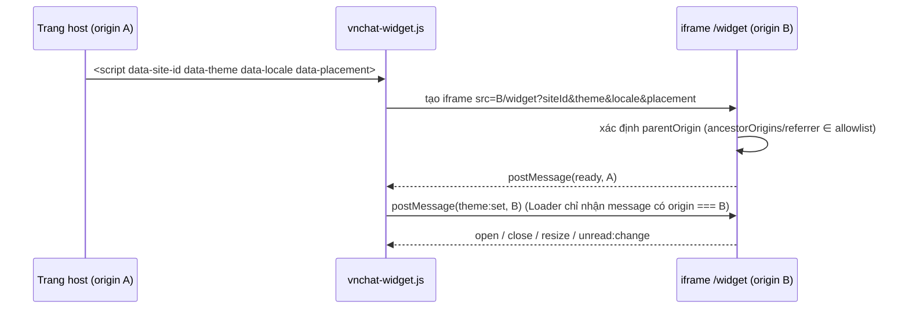

# Embed, widget & WebView architecture

> Spec §6. Một bundle React phục vụ mọi chế độ; khác nhau ở **shell** và **lớp tích hợp host** (`src/core/embed`).
> Bridge dưới đây là **giao thức phía frontend** (host ↔ iframe), backend không tham gia và không có endpoint tương ứng
> (contract map B4, B7, B8).

## 1. Chế độ chạy

| Chế độ | Route | Shell | Xác thực | Ai nhúng |
| :--- | :--- | :--- | :--- | :--- |
| Standalone đầy đủ | `/app/*` | `AppShell` (rail + inbox + chat + panel) | cookie (cùng site) hoặc bearer | – |
| Standalone gọn | `/compact/*` | `CompactShell` (luôn một pane) | như trên | WebView mobile |
| Console hỗ trợ | `/support/*` | `AgentShell` (mật độ compact) | như trên + `permissions.agent` | – |
| Admin | `/admin/*` | `AdminShell` | như trên + `permissions.admin` | – |
| Iframe đầy đủ | `/embed/*` (`/embed`, `/embed/c/:id`) | `EmbedShell` = `CompactShell` + bridge | **bearer** (đăng nhập trong iframe) | dashboard/CRM của đối tác |
| Widget khách | `/widget` | `WidgetShell` | token khách `POST /api/widget/sessions` | website khách hàng qua `vnchat-widget.js` |

`core/embed/mode.ts` suy ra chế độ **từ route** (không từ query tự khai) và cho biết có đang ở trong iframe
(`window.top !== window.self`, bọc `try/catch`).

## 2. Ai được nhúng (allowlist)

- Danh sách origin cha hợp lệ: `VITE_EMBED_PARENT_ORIGINS` (phân tách dấu phẩy, origin đầy đủ `https://crm.partner.vn`),
  đặt ở **cấu hình deploy** – người dùng cuối không sửa được. Không có giá trị nào là wildcard; rỗng = không bridge.
- Iframe không tin `?origin=`/`?parent=`. Origin cha ứng viên lấy từ `location.ancestorOrigins[0]` (Chromium/WebKit) hoặc
  origin của `document.referrer`; **chỉ chấp nhận nếu nằm trong allowlist**. Không xác định được → chạy bình thường nhưng
  tắt bridge (không gửi `resize`/`unread:change`).
- Trình duyệt chặn việc bị nhúng bằng header của static host (không phải backend API):

| Route | `Content-Security-Policy` |
| :--- | :--- |
| `/embed/*`, `/widget` | `frame-ancestors 'self' <các origin trong allowlist>` |
| mọi route khác (`/app`, `/compact`, `/support`, `/admin`, `/login`…) | `frame-ancestors 'self'` (chống clickjacking) |

  Không đặt `X-Frame-Options: DENY` cho `/embed/*` và `/widget`. Cấu hình mẫu cho Render static site / nginx nằm trong
  `deploy/` (Phase 6). Dev server Vite không gửi các header này – kiểm tra ở `vite preview` với cấu hình mẫu hoặc trên staging.

## 3. Giao thức bridge (v1)

```ts
type HostToChat =
  | { source: 'vnchat-host'; v: 1; type: 'theme:set'; theme: 'light' | 'dark' | 'system' }
  | { source: 'vnchat-host'; v: 1; type: 'locale:set'; locale: 'vi' | 'en' }
  | { source: 'vnchat-host'; v: 1; type: 'navigate'; route: string }
  | { source: 'vnchat-host'; v: 1; type: 'viewport:set'; height: number };

type ChatToHost =
  | { source: 'vnchat-embed'; v: 1; type: 'ready' }
  | { source: 'vnchat-embed'; v: 1; type: 'resize'; height: number }
  | { source: 'vnchat-embed'; v: 1; type: 'unread:change'; count: number }
  | { source: 'vnchat-embed'; v: 1; type: 'open' | 'close' }
  | { source: 'vnchat-embed'; v: 1; type: 'navigate:external'; url: string };
```

### 3.1 Quy tắc nhận (iframe)

Một message chỉ được xử lý khi **tất cả** đúng:

1. `event.origin === parentOrigin` (đã qua allowlist §2) và `event.source === window.parent`.
2. `data` là object thuần, `data.source === 'vnchat-host'`, `data.v === 1`, `type` thuộc danh sách trên.
3. Kiểm tra shape/giá trị: `theme` ∈ 3 giá trị; `locale` ∈ `vi|en`; `height` số hữu hạn 0–10000;
   `route` là đường dẫn **tương đối nội bộ** khớp `^/(embed|widget)(/[A-Za-z0-9/_-]*)?$` (không `//`, không scheme, không `..`).
4. Sai bất kỳ điều kiện → bỏ qua im lặng (log ở dev).

### 3.2 Quy tắc gửi

- `window.parent.postMessage(msg, parentOrigin)` – **không bao giờ** `'*'`.
- Không gửi token, cookie, id phiên, nội dung tin nhắn, email. `unread:change` chỉ là số; `navigate:external` chỉ URL
  `http(s)` người dùng đã bấm (host tự quyết định mở hay không).
- `resize` được throttle (rAF + chỉ gửi khi đổi ≥ 2px).

### 3.3 Trình tự



Loader biết origin B từ chính `src` của thẻ script, nên kiểm tra `event.origin === B` và `event.source === iframe.contentWindow`.

## 4. Widget loader `vnchat-widget.js`

```html
<script src="https://chat.example.vn/vnchat-widget.js" async
        data-site-id="shop-01" data-theme="system" data-locale="vi" data-placement="bottom-right"></script>
```

- Nhỏ, không phụ thuộc thư viện, không đọc cookie/storage của host, không chèn CSS toàn cục (style inline trên phần tử của nó).
- `siteId` là **định danh công khai**, không phải credential; widget gửi nó vào `meta.siteId` khi mở yêu cầu hỗ trợ để agent
  biết nguồn (backend lưu `support.meta` dạng string map). Không có API key/token nào trong JS công khai.
- Iframe: `title="VNChat"`, `allow="clipboard-write"`, `sandbox="allow-scripts allow-same-origin allow-forms allow-popups
  allow-popups-to-escape-sandbox allow-downloads"`, `referrerpolicy="strict-origin-when-cross-origin"` (để iframe đọc được
  origin host qua referrer khi trình duyệt không có `ancestorOrigins`).
- Trạng thái: `closed` (chỉ nút tròn 56px), `open` (panel 380×600, co theo viewport; < 480px → full-screen với safe-area).
  Không animation lặp; tôn trọng reduced motion.
- Widget tắt (`CHAT-403-001`) → iframe gửi `close` và loader ẩn nút.

## 5. Xác thực & lưu trữ theo chế độ

| Chế độ | Thông tin | Nơi lưu | Lý do |
| :--- | :--- | :--- | :--- |
| Standalone cùng site | cookie `jwt` httpOnly | trình duyệt | FE không chạm token |
| Standalone khác site / iframe đầy đủ | `token` từ login | `localStorage["vnchat.auth.token"]` của origin iframe (bị **partition** theo site cha ở Safari/Chrome/Firefox) | cookie SameSite=strict không đi trong ngữ cảnh bên thứ ba; mỗi site host là một phiên riêng – chấp nhận được |
| Widget khách | `visitorToken` (nối danh tính khách) | `localStorage["vnchat.widget.visitor"]` (partition theo site host) | backend khuyến nghị giữ để xem lại lịch sử |
| Widget khách | JWT phiên khách | bộ nhớ + `localStorage["vnchat.widget.token"]` (partition theo site host), gửi bằng Bearer; mọi request `credentials: "omit"` (không gửi/lưu cookie – B15) | hết hạn → tự tạo lại bằng `visitorToken` (`features/widget/session.ts`) |

- Mọi truy cập storage bọc `try/catch`; storage bị chặn → vẫn chạy được trong phiên hiện tại (mất khi reload).
- Không dùng Storage Access API (không cần vì dùng bearer); không đặt token vào URL, `postMessage` hay log.
- Hết phiên (`401` / `session.revoked`) → xoá token + quay về form đăng nhập trong iframe.

## 6. Native WebView

- Dùng URL `/compact/*` (hoặc `/embed/*` nếu app native muốn bridge). Viewport: `width=device-width, initial-scale=1,
  viewport-fit=cover` – **không** khoá zoom.
- **Safe-area**: header, bottom nav, composer có `padding: env(safe-area-inset-*)`.
- **Bàn phím ảo**: `visualViewport` resize → `--app-height`; composer bám đáy vùng nhìn thấy, feed giữ tin cuối khi bàn phím mở.
- **Back**: drawer/sheet/panel chi tiết mở bằng search param (`?panel=details`), nên `history.back()` đóng chúng trước rồi mới
  rời màn. Host Android gọi `webView.goBack()` khi `canGoBack()`; iOS bật `allowsBackForwardNavigationGestures`.
- **Bridge native (chỉ khi host xác nhận)**: chỉ bật nếu host đã inject một trong các đối tượng trước khi trang chạy:
  `window.webkit.messageHandlers.vnchat` (iOS), `window.VNChatAndroid.postMessage` (Android), `window.ReactNativeWebView`.
  Chat → host: cùng kiểu `ChatToHost` (JSON). Host → chat: `window.vnchatHost.receive(msg)` với cùng `HostToChat` và cùng
  bước kiểm tra §3.1 (trừ kiểm tra origin, vì không qua `postMessage`). Không có đối tượng nào → không bridge.
- **File picker**: `<input type="file">`. iOS WKWebView hỗ trợ sẵn; Android cần host cài `WebChromeClient.onShowFileChooser`.
- **Tải tệp / link ngoài**: gửi `navigate:external {url}` cho host native; trên web thường mở tab mới
  `rel="noopener noreferrer"`.
- **Nền / quay lại**: `visibilitychange` → `visible` thì kết nối lại socket nếu bị ngắt rồi `GET /api/sync`.
- Capacitor: **không** thêm (spec ghi là tuỳ chọn khi muốn đóng gói app riêng).

## 7. Cô lập & nội dung

- Nội dung tin là text thuần: render bằng React (escape sẵn), link tự nhận diện chỉ `http(s)` với `target="_blank"
  rel="noopener noreferrer"`; không `dangerouslySetInnerHTML` → không cần DOMPurify. Nếu sau này render HTML thì bắt buộc
  sanitize.
- Ảnh/tệp chỉ từ URL backend trả (Cloudinary `secure_url`); không tải script ngoài.
- Iframe con (nếu có) không được dùng. Bundle không chứa secret (`VITE_*` là công khai – chỉ URL và allowlist).

## 8. Ma trận kiểm thử (Phase 6–7)

| Kịch bản | Môi trường | Kỳ vọng |
| :--- | :--- | :--- |
| Host trong allowlist nhúng `/embed` | Chrome, Firefox, Safari | hiển thị, `ready` tới host, `theme:set` đổi theme |
| Host **ngoài** allowlist | Chrome | trình duyệt chặn khung (CSP `frame-ancestors`) |
| Message giả origin / sai `source` / sai shape | Playwright | bị bỏ qua, không đổi state |
| Cookie bên thứ ba bị chặn | Safari (ITP), Chrome chặn 3P cookie | đăng nhập bearer trong iframe vẫn chạy |
| Storage bị chặn | Chrome "Block all cookies" | widget vẫn chat được trong phiên |
| Widget tắt | admin `widget.enabled=false` | launcher ẩn |
| Bàn phím ảo + safe-area | iOS Safari, Android Chrome, Android WebView | composer không bị che, không cuộn ngang |
| Back cứng Android | WebView | đóng drawer trước, rồi về inbox |
