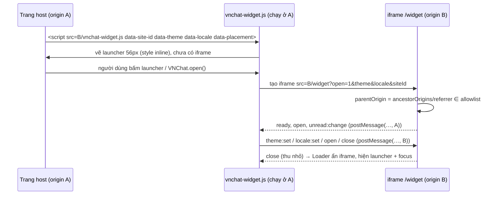

# Embed, widget & WebView architecture

> Spec §6. Một bundle React phục vụ mọi chế độ; khác nhau ở **shell** và **lớp tích hợp host** (`src/core/embed`).
> Bridge dưới đây là **giao thức phía frontend** (host ↔ iframe), backend không tham gia và không có endpoint tương ứng
> (contract map B4, B7, B8). Trạng thái: **đã triển khai ở Phase 6** – mã ở `src/core/embed/{protocol,bridge}.ts`,
> `src/app/shells/EmbedRoot.tsx`, `src/features/widget/WidgetPage.tsx`, `public/vnchat-widget.js`; cấu hình deploy ở `deploy/`.

## 1. Chế độ chạy

| Chế độ | Route | Shell | Xác thực | Ai nhúng |
| :--- | :--- | :--- | :--- | :--- |
| Standalone đầy đủ | `/app/*` | `AppShell` (rail + inbox + chat + panel) | cookie (cùng site) hoặc bearer | – |
| Standalone gọn | `/compact/*` | `AppShell variant="compact"` (luôn một pane) | như trên | WebView mobile |
| Console hỗ trợ | `/support/*` | `AgentShell` (mật độ compact) | như trên + `permissions.agent` | – |
| Admin | `/admin/*` | `AdminShell` | như trên + `permissions.admin` | – |
| Iframe đầy đủ | `/embed`, `/embed/login`, `/embed/signup`, `/embed/c/:id`, `/embed/search`… | `EmbedRoot` → `AppShell variant="embed" base="/embed"` | **bearer** (đăng nhập ngay trong iframe) | dashboard/CRM của đối tác, WebView native |
| Widget khách | `/widget` | `WidgetPage` | token khách `POST /api/widget/sessions` | website khách hàng qua `vnchat-widget.js` |

- Chế độ suy ra **từ route** (không từ query tự khai). Trong `/embed` mọi link nội bộ giữ tiền tố `/embed`
  (`ShellContext.base`, `authBase()` cho trang đăng nhập/đăng ký và `?next=`); mục *Console hỗ trợ*/*Quản trị* ở menu tài
  khoản mở **tab mới** thay vì điều hướng trong khung.
- `inIframe` (`core/embed/bridge.ts`): `window.self !== window.top`, bọc `try/catch` (bị chặn truy cập `top` = đang ở iframe
  khác origin).

## 2. Ai được nhúng (allowlist)

- Danh sách origin cha hợp lệ: `VITE_EMBED_PARENT_ORIGINS` (phân tách dấu phẩy, origin đầy đủ `https://crm.partner.vn`),
  đặt ở **cấu hình deploy** – người dùng cuối không sửa được. Không có wildcard; rỗng = không bridge.
- Iframe không tin `?origin=`/`?parent=`. Origin cha ứng viên lấy từ `location.ancestorOrigins[0]` (Chromium/WebKit) hoặc
  origin của `document.referrer`; **chỉ chấp nhận nếu nằm trong allowlist** (`resolveParentOrigin`). Có `ancestorOrigins`
  thì không xét referrer. Không xác định được → chạy bình thường nhưng tắt bridge (không gửi gì).
- Trình duyệt chặn việc bị nhúng bằng header của static host (không phải backend API):

| Route | `Content-Security-Policy` |
| :--- | :--- |
| `/embed`, `/embed/*`, `/widget` | `frame-ancestors 'self' <các origin trong allowlist>` |
| mọi route khác (`/app`, `/compact`, `/support`, `/admin`, `/login`…) | `frame-ancestors 'self'` (chống clickjacking) |

- Không đặt `X-Frame-Options: DENY` cho `/embed*` và `/widget`. Mẫu nginx + Render và cách kiểm tra sau deploy:
  [`deploy/README.md`](../deploy/README.md). Dev server và `vite preview` gửi đúng các header này (plugin `frameAncestors`
  trong `vite.config.ts`, đọc cùng `VITE_EMBED_PARENT_ORIGINS`) nên kiểm thử nhúng chạy được ở máy dev.
- CSP chỉ chặn việc **tải** một trang vào khung, không chặn điều hướng phía client bên trong khung đã mở. Vì vậy thêm hai
  chốt ở frontend: `?next=` của `/embed/login` chỉ nhận đường dẫn dưới `/embed` (`safeNext(next, "/embed", "/embed")`),
  và `FrameGuard` ở gốc router – khi đang trong iframe, mọi route ngoài `/embed`, `/widget` hiển thị "Mở trong tab mới"
  thay vì nội dung (không bao giờ render `/admin`, `/support`, `/app` trong trang đối tác).

## 3. Giao thức bridge (v1)

```ts
type HostToChat =
  | { source: 'vnchat-host'; v: 1; type: 'theme:set'; theme: 'light' | 'dark' | 'system' }
  | { source: 'vnchat-host'; v: 1; type: 'locale:set'; locale: 'vi' | 'en' }
  | { source: 'vnchat-host'; v: 1; type: 'navigate'; route: string }
  | { source: 'vnchat-host'; v: 1; type: 'viewport:set'; height: number }
  | { source: 'vnchat-host'; v: 1; type: 'open' | 'close' };          // widget: host mở/đóng panel

type ChatToHost =
  | { source: 'vnchat-embed'; v: 1; type: 'ready' }                    // đúng một lần mỗi lần tải trang
  | { source: 'vnchat-embed'; v: 1; type: 'resize'; height: number }
  | { source: 'vnchat-embed'; v: 1; type: 'unread:change'; count: number }
  | { source: 'vnchat-embed'; v: 1; type: 'open' | 'close' }           // widget: người dùng mở/thu nhỏ trong khung
  | { source: 'vnchat-embed'; v: 1; type: 'hide' }                     // widget tắt (CHAT-403-001) → ẩn hẳn launcher
  | { source: 'vnchat-embed'; v: 1; type: 'navigate:external'; url: string };
```

### 3.1 Quy tắc nhận (iframe)

Một message chỉ được xử lý khi **tất cả** đúng:

1. `event.origin === parentOrigin` (đã qua allowlist §2) và `event.source === window.parent`.
2. `data` là object thuần (prototype `Object`), `data.source === 'vnchat-host'`, `data.v === 1`, `type` thuộc danh sách trên.
3. Kiểm tra shape/giá trị (`parseHostMessage`): `theme` ∈ 3 giá trị; `locale` ∈ `vi|en`; `height` số hữu hạn 0–10000;
   `route` là đường dẫn **tương đối nội bộ** khớp `^/(embed|widget)(/[A-Za-z0-9/_-]*)?(\?[A-Za-z0-9=&_%.-]*)?$`
   (không `//`, không scheme, không `..`).
4. Sai bất kỳ điều kiện → bỏ qua im lặng (`console.warn` ở dev).

`theme:set`/`locale:set` từ host **không ghi storage** – không ghi đè lựa chọn người dùng đã lưu ở app standalone.
`viewport:set` đặt `--app-height` cho WebView không tự co `visualViewport` khi bàn phím mở.

### 3.2 Quy tắc gửi

- `window.parent.postMessage(msg, parentOrigin)` – **không bao giờ** `'*'`.
- Không gửi token, cookie, id phiên, nội dung tin nhắn, email. `unread:change` chỉ là số; `navigate:external` chỉ URL
  `http(s)` người dùng đã bấm (host tự quyết định mở hay không).
- `resize` được gộp theo frame (rAF) và chỉ gửi khi đổi ≥ 2px; `ready` chỉ gửi một lần.
- Host → widget `open`/`close` đổi trạng thái panel **không** báo ngược lại (tránh vòng lặp).

### 3.3 Trình tự (widget)



Loader biết origin B từ chính `src` của thẻ script, nên kiểm tra `event.origin === B` và `event.source === iframe.contentWindow`.

## 4. Widget loader `vnchat-widget.js`

```html
<script src="https://chat.example.vn/vnchat-widget.js" async
        data-site-id="shop-01" data-theme="system" data-locale="vi" data-placement="bottom-right"></script>
```

- Vanilla JS, không phụ thuộc thư viện, không đọc cookie/storage của host, không chèn CSS toàn cục (style inline trên phần
  tử của nó). Thuộc tính `data-*` sai giá trị → dùng mặc định.
- `siteId` (`^[A-Za-z0-9_-]{1,64}$`) là **định danh công khai**, không phải credential; widget gửi nó vào `meta.siteId` khi
  mở yêu cầu hỗ trợ để agent biết nguồn. Không có API key/token nào trong JS công khai.
- Launcher vẽ trên trang host (nút 56px, `aria-label`, `aria-expanded`, badge số chưa đọc `99+`); iframe chỉ tạo khi mở
  lần đầu. Iframe: `title="VNChat"`, `allow="clipboard-write"`, `sandbox="allow-scripts allow-same-origin allow-forms
  allow-popups allow-popups-to-escape-sandbox allow-downloads"`, `referrerpolicy="strict-origin-when-cross-origin"`.
- Kích thước: panel `min(400px, 100vw-32px) × min(640px, 100vh-32px)`; viewport < 480px → toàn màn hình. Tôn trọng
  `prefers-reduced-motion`, không animation lặp.
- API cho host: `window.VNChat.open()`, `.close()`, `.setTheme('light'|'dark'|'system')`, `.setLocale('vi'|'en')`,
  `.on('ready'|'open'|'close'|'unread', fn)`.
- Widget tắt (`CHAT-403-001`) → iframe gửi `hide`, loader gỡ launcher + iframe.

## 5. Xác thực & lưu trữ theo chế độ

| Chế độ | Thông tin | Nơi lưu | Lý do |
| :--- | :--- | :--- | :--- |
| Standalone cùng site | cookie `jwt` httpOnly | trình duyệt | FE không chạm token |
| Standalone khác site (`VITE_AUTH_TRANSPORT=bearer`) | `token` từ login | `localStorage["vnchat.auth.token"]` | cookie SameSite=strict không đi khác site |
| Iframe đầy đủ `/embed` (và mọi trang chạy trong iframe) | `token` từ login | `localStorage["vnchat.embed.token"]` của origin iframe (bị **partition** theo site cha) | key riêng → không đè phiên standalone cùng origin; mỗi site host là một phiên riêng – chấp nhận được |
| Widget khách | `visitorToken` (nối danh tính khách) | `localStorage["vnchat.widget.visitor"]` (partition theo site host) | backend khuyến nghị giữ để xem lại lịch sử |
| Widget khách | JWT phiên khách | `localStorage["vnchat.widget.token"]` (partition theo site host) | hết hạn → tự tạo lại bằng `visitorToken` (`features/widget/session.ts`) |

- `/widget`, `/embed*` và mọi trang chạy trong iframe gọi `isolateSession(scope)` ngay khi khởi động (`src/main.tsx`):
  axios dùng fetch adapter với `credentials: "omit"` (không gửi và **không lưu** cookie, kể cả `Set-Cookie: jwt` của
  `POST /api/widget/sessions` – B15), Socket.IO `withCredentials: false`, token gửi bằng Bearer.
- Mọi truy cập storage bọc `try/catch`; storage bị chặn → vẫn chạy được trong phiên hiện tại (mất khi reload).
- Không dùng Storage Access API (không cần vì dùng bearer); không đặt token vào URL, `postMessage` hay log.
- Hết phiên (`401` / `session.revoked`) → xoá token + quay về `/embed/login` trong iframe.

## 6. Native WebView

- Dùng URL `/compact/*` (không bridge) hoặc `/embed/*` (có bridge). Viewport: `width=device-width, initial-scale=1,
  viewport-fit=cover` – **không** khoá zoom.
- **Safe-area**: header, bottom nav, composer có `padding: env(safe-area-inset-*)`.
- **Bàn phím ảo**: `visualViewport` resize → `--app-height` (`core/ui/hooks.ts`); composer bám đáy vùng nhìn thấy. Host
  native có thể gửi `viewport:set` nếu WebView không co `visualViewport`.
- **Back**: panel chi tiết mở bằng search param (`?panel=details`, push history), nên `history.back()` đóng panel trước rồi
  mới rời màn. Host Android gọi `webView.goBack()` khi `canGoBack()`; iOS bật `allowsBackForwardNavigationGestures`.
- **Bridge native**: chỉ bật nếu host đã inject một trong các đối tượng **trước khi trang chạy**:
  `window.webkit.messageHandlers.vnchat` (iOS, nhận object), `window.VNChatAndroid.postMessage` (Android, nhận chuỗi JSON),
  `window.ReactNativeWebView.postMessage` (chuỗi JSON). Chat → host: `ChatToHost`. Host → chat:
  `window.vnchatHost.receive(msg)` với `HostToChat` và cùng bước kiểm tra §3.1 (trừ origin, vì không qua `postMessage`).
  Không có đối tượng nào → không bridge. Mẫu host: [`examples/host/README.md`](../examples/host/README.md).
- **File picker**: `<input type="file">`. iOS WKWebView hỗ trợ sẵn; Android cần host cài `WebChromeClient.onShowFileChooser`.
- **Link ngoài**: có bridge native → gửi `navigate:external {url}` (host mở trình duyệt hệ thống); web thường mở tab mới
  `rel="noopener noreferrer"`.
- **Nền / quay lại**: `visibilitychange` → `visible` thì kết nối lại socket nếu bị ngắt rồi `GET /api/sync`.
- Capacitor: **không** thêm (spec ghi là tuỳ chọn khi muốn đóng gói app riêng).

## 7. Cô lập & nội dung

- Nội dung tin là text thuần: render bằng React (escape sẵn), link tự nhận diện chỉ `http(s)` với `target="_blank"
  rel="noopener noreferrer"`; không `dangerouslySetInnerHTML` → không cần DOMPurify. Nếu sau này render HTML thì bắt buộc
  sanitize.
- Ảnh/tệp chỉ từ URL backend trả (Cloudinary `secure_url`); không tải script ngoài.
- Bundle không chứa secret (`VITE_*` là công khai – chỉ URL và allowlist).

## 8. Ma trận kiểm thử

Unit: `src/core/embed/protocol.test.ts` (shape/route/origin/URL). Kiểm thử trình duyệt Phase 6 chạy Chromium headless với
backend thật, host `http://127.0.0.1:5180` (`examples/host`) khác site với app `http://localhost:5174`.

| Kịch bản | Môi trường | Kỳ vọng | Phase 6 |
| :--- | :--- | :--- | :--- |
| Header CSP theo route | dev server | `/embed`, `/widget` có allowlist; `/app` chỉ `'self'` | ✅ Chromium |
| Loader: launcher, mở lần đầu tạo iframe, `ready` một lần, `open`/`close`, focus về launcher | host demo | như mô tả §4 | ✅ Chromium |
| Phiên khách trong iframe khác site | host demo | Bearer ở `vnchat.widget.token`, không có cookie `jwt` | ✅ Chromium |
| Agent trả lời khi widget thu nhỏ | host demo + console | `unread:change 1` → badge launcher; mở lại → `0` | ✅ Chromium |
| `/embed` chưa đăng nhập → `/embed/login` trong khung; đăng nhập bearer | host demo | token ở `vnchat.embed.token`, không cookie, standalone vẫn chưa đăng nhập | ✅ Chromium |
| Host `navigate` / `theme:set` / `locale:set` | host demo | áp trong khung | ✅ Chromium |
| Message từ origin khác (iframe lạ cùng trang host) | host demo | bỏ qua | ✅ Chromium |
| Host **ngoài** allowlist nhúng `/embed`; host hợp lệ nhúng `/app` | Chromium | khung bị chặn (CSP) | ✅ Chromium |
| `/embed/login?next=/admin/users`; `history.pushState('/admin/users')` trong khung | host demo | về `/embed`; `FrameGuard` thay vì trang quản trị | ✅ Chromium |
| Viewport < 480px | host demo | widget toàn màn hình | ✅ Chromium |
| Bridge native giả lập (`ReactNativeWebView`) | Chromium mobile emulation | `ready`, `theme:set`, `viewport:set` áp; route ngoài `/embed` bị bỏ | ✅ Chromium |
| Cookie bên thứ ba bị chặn | Safari (ITP), Firefox | đăng nhập bearer trong iframe vẫn chạy | Phase 7 |
| Storage bị chặn | Chrome "Block all cookies" | widget vẫn chat được trong phiên | Phase 7 |
| Widget tắt | admin `widget.enabled=false` | iframe gửi `hide`, launcher biến mất | Phase 7 (Phase 5 đã kiểm phía app) |
| Bàn phím ảo + safe-area | iOS Safari, Android Chrome, Android WebView thật | composer không bị che, không cuộn ngang | Phase 7 (thiết bị thật) |
| Back cứng Android | WebView thật | đóng panel trước, rồi về inbox | Phase 7 (thiết bị thật) |
